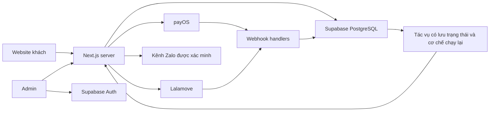

# NAVIDO Commerce — Overall Plan và quyết định thiết kế

**Ngày:** 2026-10-05

**Trạng thái:** Bước 0 đã implement và kiểm tra local; chưa tạo hạ tầng cloud/deploy. Bước 1–7 vẫn là roadmap.

**Mục tiêu:** Khách đặt món trên website, thấy đủ chi phí trước thanh toán, chọn đến lấy hoặc giao tận nơi; nhân viên quản lý menu và đơn trong admin, dùng iPOS thủ công.

Tài liệu này là roadmap tổng thể và nguồn quyết định cho các plan từng bước. Bắt đầu bằng [plan chi tiết bước 0](2026-10-05-navido-commerce-step-0.md). Plan chi tiết bước 1–7 được viết lần lượt dựa trên kết quả bước trước; các phần bên dưới xác định phạm vi, thứ tự và điều kiện ship của từng bước, không phải những tính năng đã được làm.

## 1. Quyết định và giả định cho bản đầu

- Một cửa hàng NAVIDO; đơn vị tiền VND, lưu số nguyên; giờ vận hành theo `Asia/Ho_Chi_Minh`.
- Tiếp tục dùng Next.js App Router + TypeScript + next-intl trong dự án hiện tại. Website, `/admin` và backend cùng repo và deployment; không cần thêm ứng dụng backend riêng.
- Đề xuất Vercel cho runtime Next.js, Supabase cho PostgreSQL và Auth. Đây là lựa chọn lập kế hoạch, chưa có bằng chứng các tài khoản đã được tạo hoặc gói dịch vụ đã được mua.
- Admin dùng tiếng Việt, đường dẫn `/admin` không có locale. Website khách giữ `vi`, `en`, `ko`.
- Theo lựa chọn chủ dự án, bước 0 gồm import menu hiện có vào PostgreSQL và quản lý danh mục/món tại `/admin/menu`. Website khách vẫn đọc file ở bước 0–1; bước 2 mới chuyển sang menu DB đã công bố.
- Khách đặt hàng không cần tài khoản. Link theo dõi có token ngẫu nhiên khó đoán; mã đơn dễ đọc chỉ dùng trao đổi với quán, không phải quyền đọc dữ liệu cá nhân.
- Bản đầu chỉ chuyển khoản, chưa COD; trước payOS nhân viên đối chiếu ngân hàng thủ công. Đây là mặc định đề xuất để bước 3 có thể dùng độc lập.
- Lalamove là nhà giao hàng đầu tiên; payOS xác nhận thanh toán; kênh Zalo chính thức còn cần xác minh tài khoản/quyền và khả năng gửi thông báo nội bộ.
- iPOS tiếp tục là hệ thống POS của quán. Có mã tham chiếu/đánh dấu đã nhập iPOS trong admin để tránh nhập hai lần; không đồng bộ API.
- Không viết hoặc chạy E2E/Playwright trong chuỗi triển khai này, bao gồm các script `verify:*` gọi Playwright. Giữ các test có sẵn. Dùng unit, component, integration và kiểm tra thủ công có ghi kết quả.

## 2. Kiến trúc và các ranh giới

Các module được thêm khi bước sở hữu chúng bắt đầu: `admin-auth`, `catalog`, `orders`, `payments`, `delivery`, `notifications`. Chỉ module tích hợp biết payload/API của nhà cung cấp. Giá, trạng thái, quyền truy cập và tổng đơn do server quyết định.

Các bảng được bổ sung theo milestone, không tạo toàn bộ ngay bước 0:

| Bước | Dữ liệu được thêm |
| --- | --- |
| 0 | `admin_memberships`, danh mục/món, trạng thái công bố/còn bán, lịch sử thay đổi menu và import dữ liệu nguồn |
| 1 | Tùy chọn món, ảnh upload và cấu hình giờ nhận đơn trên catalog có sẵn |
| 2 | Phiên bản menu đã công bố và thông tin phục vụ cache/cập nhật website |
| 3 | Đơn, snapshot món và giá, trạng thái thanh toán thủ công, lịch sử đơn, token tra cứu |
| 4 | Báo giá giao hàng, lần đặt vận đơn, sự kiện webhook, tác vụ giao hàng |
| 5 | Yêu cầu thanh toán, giao dịch, sự kiện webhook, yêu cầu hoàn tiền/đối soát |
| 6 | Lần gửi thông báo, trạng thái gửi, số lần thử lại |

Tác vụ nền phải được lưu bền vững trước khi phản hồi webhook. Không dùng `setTimeout` hoặc chỉ giữ promise trong một request để đảm bảo gửi tin/đặt chuyến. Chọn và cấu hình cơ chế chạy tác vụ có retry ở bước 4; webhook payOS ở bước 5 dùng lại cơ chế đó.

## 3. Kế hoạch phát hành

| Bước | Phần dùng được sau khi ship | Phụ thuộc | Điều kiện bật |
| --- | --- | --- | --- |
| 0 | Đăng nhập an toàn; menu hiện có trong DB; quản lý danh mục/món và preview nội bộ | Tài khoản hạ tầng | Auth, RLS/RPC, import đủ dữ liệu, quyền sửa, audit và môi trường được kiểm tra |
| 1 | Quản lý tùy chọn món, ảnh upload và giờ nhận đơn | 0 | Quy tắc tùy chọn và quyền upload/cấu hình được kiểm tra |
| 2 | Website đọc menu do admin công bố | 1 | Đối chiếu dữ liệu và cập nhật mọi nơi dùng menu |
| 3 | Đặt món đến lấy, chuyển khoản thủ công, theo dõi đơn | 2 | Nhân viên có quy trình đối chiếu tiền và xử lý đơn |
| 4 | Admin báo giá/đặt/theo dõi Lalamove | 3 | Production key, ví và địa chỉ quán đã xác minh |
| 5 | payOS xác nhận tiền; checkout giao hàng có đủ chi phí | 4 | Webhook, đối soát và lỗi đặt chuyến đã được kiểm tra |
| 6 | Nhận thông báo đơn qua Zalo | 3, triển khai sau 5 | Chứng minh gửi được qua kênh chính thức của quán |
| 7 | Vận hành công khai đầy đủ hai hình thức nhận hàng | 0–6 | Nhân viên nghiệm thu và thử đơn thật có kiểm soát |

Ship nội bộ cũng phải có chức năng nhân viên sử dụng được. Một màn hình mock hoặc một adapter chỉ chạy với dữ liệu giả chưa được tính là milestone đã đưa vào sử dụng. Nếu chưa có credential của bên thứ ba, ghi rõ “code verified, chưa production-ready”.

### Bước 0 — Hạ tầng, đăng nhập và quản lý menu DB

Thực hiện theo plan chi tiết được liên kết ở đầu tài liệu. Đầu ra gồm schema quyền admin và catalog, server client, đăng nhập/đăng xuất, kiểm tra quyền theo request, root layout admin, endpoint kiểm tra kết nối có bảo vệ, import menu nguồn và giao diện `/admin/menu`, tài liệu môi trường và cách triển khai migration.

Import normalized menu giữ ID, tên ba ngôn ngữ, giá VND, thứ tự, metadata nguồn và ghi chú cần review. Baseline có 14 danh mục/130 bản ghi; không bỏ bản ghi nghi trùng hoặc Extras, 3 MOCK_BEANS không tự công bố. Món đang hiển thị trên website được import thành published, không lấy nhãn draft trong helper cũ làm điều kiện ẩn. Import lại không nhân bản hoặc ghi đè chỉnh sửa trong DB; có manifest/checksum và đối chiếu trước bàn giao.

Owner thêm/sửa/archive món, thêm/sửa danh mục, chỉnh tên/giá/thứ tự/trạng thái công bố và review dữ liệu; staff chỉ đổi còn bán/tạm hết qua RPC có kiểm tra quyền. RLS bảo vệ cả truy cập trực tiếp, mỗi thay đổi có audit và version chống ghi đè đồng thời. Preview nội bộ đọc menu DB published; admin thông báo thay đổi chưa xuất hiện trên website khách.

Website công khai vẫn đọc file trong bước này. Không tạo schema đơn hàng hoặc yêu cầu khóa payOS/Lalamove/Zalo. Không triển khai upload ảnh/tùy chọn món trong bước 0.

**Nghiệm thu:** build/public không cần DB; Auth/membership fail closed; staging đăng nhập và thu hồi quyền đúng; import đủ menu/metadata, chạy lại an toàn; owner/staff quản lý đúng quyền; version conflict và audit hoạt động; preview nội bộ không lộ món draft/mock/archived.

### Bước 1 — Mở rộng catalog: tùy chọn, ảnh và cấu hình vận hành

1. Dùng catalog/import/admin đã có từ bước 0, không tạo lại schema hoặc import lại để ghi đè nội dung nhân viên đã sửa. Bổ sung mô tả ba ngôn ngữ nếu cần cho hiển thị/đặt món, EN/KO thiếu fallback VI và được đánh dấu để review.
2. Rà soát size, nóng/lạnh, đường/đá và Extras của menu thực tế; định nghĩa nhóm tùy chọn bắt buộc/tùy chọn thêm, giới hạn lựa chọn và phụ phí trước bước 3. Bản ghi Extras nguồn vẫn được giữ để đối chiếu, không tự coi là món bán độc lập trong checkout.
3. Dùng asset đã có để khởi tạo ảnh; thêm upload vào object storage với giới hạn loại/kích thước và quyền nhân viên, không ghi file upload vào filesystem của Vercel.
4. Thêm cấu hình giờ nhận đơn và thời gian chuẩn bị; phân biệt giờ phục vụ khách và giờ nhận đơn cuối. Quyền owner quản lý giá/nội dung/cấu hình, staff chỉ thao tác vận hành được cho phép; tái sử dụng audit và kiểm tra membership cho schema mới.

**Kiểm tra:** giới hạn tùy chọn/phụ phí, quyền cập nhật và upload, asset lỗi, cấu hình giờ hợp lệ. **Ship:** catalog đủ dữ liệu/tùy chọn/ảnh/cấu hình để bước 2–3 sử dụng; website vẫn đọc file tới bước 2.

### Bước 2 — Website dùng menu từ admin

1. Đổi repository menu sang đọc dữ liệu đã công bố; server-side asynchronous interface thay repository đồng bộ hiện tại.
2. Cập nhật tất cả consumer: trang Menu, Home/signature, Roastery và selectors. Các tham chiếu món nổi bật phải được lọc nếu món đã ẩn hoặc lưu trữ.
3. Thiết lập công bố và cache invalidation sau khi lưu; hiển thị thay đổi trong vòng 60 giây. Checkout ở bước 3 luôn đọc lại giá/trạng thái mới từ DB dù trang hiển thị dùng cache.
4. Đối chiếu danh mục, ID, giá và thứ tự trước khi đổi nguồn. Giữ snapshot đã công bố gần nhất để rollback nội dung có kiểm soát; không tự âm thầm chuyển về menu gốc đã cũ khi DB lỗi.
5. Chuyển kiểm tra generated file thành kiểm tra nguồn import lịch sử, không yêu cầu DB khớp file gốc khi build.

**Kiểm tra:** một thay đổi xuất hiện ở cả ba locale và mọi consumer; mục chưa công bố không rò ra public; category mới có layout mặc định; DB không đọc được có trạng thái lỗi rõ ràng. **Ship:** menu admin là nguồn dữ liệu đang phục vụ khách, không cần deploy lại khi đổi giá.

### Bước 3 — Giỏ hàng, checkout đến lấy và xử lý đơn

1. Giỏ hàng giữ item ID, option ID, số lượng và ghi chú; server kiểm tra món còn bán và tính lại tổng khi checkout. Thay đổi giá phải được khách xác nhận lại trước tạo yêu cầu trả tiền.
2. Bản đầu chỉ bật đến lấy. Thu tên, số điện thoại, ghi chú và thời điểm nhận theo khả năng quán. Giờ nhận đơn và thời gian chuẩn bị được cấu hình, không tự dùng giờ mở cửa làm giờ nhận đơn cuối.
3. Tạo đơn và snapshot trong một transaction, có khóa chống tạo trùng khi bấm lại. Tiền món, phụ phí, giảm giá nếu thực sự được hỗ trợ và tổng tiền được thể hiện trước thanh toán; không thêm hệ thống coupon ở bản đầu.
4. Hiển thị tài khoản ngân hàng/QR với số tiền và mã đơn. Nút “tôi đã chuyển khoản” chỉ ghi nhận yêu cầu kiểm tra, không đổi thành paid. Nhân viên chỉ xác nhận sau khi thấy giao dịch ngân hàng.
5. Admin có hàng chờ, nhận/từ chối đơn, xác nhận tiền có tham chiếu giao dịch, đang chuẩn bị, sẵn sàng, hoàn tất, đánh dấu đã nhập iPOS.
6. Link tracking dùng token ngẫu nhiên lưu dạng hash; không dùng mã đơn tuần tự làm khóa truy cập. Trang theo dõi tự tải lại trạng thái định kỳ khi mở và giới hạn thông tin cá nhân hiển thị.
7. Có hủy/hoàn tiền thủ công với người thực hiện, số tiền và tham chiếu; không đánh dấu đã hoàn tiền chỉ vì đã gửi yêu cầu hoàn.

**Kiểm tra:** sửa giá từ client, double submit, món hết sau khi vào giỏ, token sai, quyền xem đơn, nhân viên bấm hai lần, xác nhận tiền thiếu/sai mã. **Ship:** nhận đơn pickup thật; chuyển khoản và iPOS vẫn được đối chiếu thủ công.

### Bước 4 — Lalamove cho vận hành admin

1. Xác minh địa chỉ và tọa độ quán, phương tiện/dịch vụ thực phẩm khả dụng, sandbox/production key và số dư ví.
2. Adapter báo giá nhận tọa độ đã xác nhận, trả `quotationId`, `expiresAt`, giá VND và dịch vụ. Một địa chỉ chữ tự do chưa đủ để giả định có tọa độ chính xác.
3. Admin nhập địa chỉ/tọa độ nhận, xem báo giá và đặt chuyến cho đơn đã trả tiền, được quán nhận. Luồng tạo đơn giao thủ công phải báo tổng cho khách trước xác nhận thanh toán; nếu giá đổi, quán chịu chênh lệch đã được nhân viên chấp nhận.
4. Bản release bước 4 ưu tiên booking từ admin. Checkout giao tận nơi tự phục vụ chỉ mở ở bước 5 sau khi có đối soát tự động và chính sách báo giá hết hạn.
5. Lưu từng lần đặt, external ID dạng string, trạng thái tìm tài xế/đã nhận/đã lấy/giao thành công/hủy. Nhận webhook xác thực, chống sự kiện trùng và xử lý cập nhật đến sai thứ tự.
6. Khi create-order timeout không rõ kết quả, đưa về `needs_review` và đối soát trước khi tạo lại; không retry POST mù gây hai tài xế.
7. Thêm tác vụ bền vững, retry có giới hạn và màn hình lỗi thiếu ví/không có tài xế/ngoài vùng. Thiết lập lịch lấy món phù hợp bếp; không coi API trả mã đơn là tài xế đã nhận.

**Kiểm tra:** hết hạn báo giá, sai tọa độ, ví thiếu, timeout sau khi nhà cung cấp đã nhận, webhook lặp, hoàn tất đến trước sự kiện cũ. **Ship:** nhân viên tạo và theo dõi chuyến từ admin mà không nhập lại toàn bộ trên app Lalamove.

### Bước 5 — payOS và checkout giao hàng

1. Tạo payment adapter; mỗi lần thanh toán có ID và tổng tiền đã chốt. Nhận webhook có kiểm tra chữ ký, currency, mã đơn, số tiền và trạng thái; lưu giao dịch trước khi chạy tác vụ tiếp theo.
2. Redirect từ payOS chỉ dẫn khách về tracking. Xác nhận paid dựa trên webhook hợp lệ hoặc đối soát server với API nhà cung cấp.
3. Sai số tiền, chuyển trùng, trả tiền sau hết hạn hoặc đơn đã hủy đi vào hàng chờ đối soát; không tự làm món/đặt chuyến cho các trường hợp chưa hợp lệ.
4. Thêm chọn địa chỉ có tọa độ và kiểm tra vùng giao ở checkout; chọn dịch vụ geocoding phù hợp và xác minh chi phí/quyền trước khi thực hiện phần bản đồ. Khách xác nhận vị trí nhận, tên, số điện thoại và chỉ dẫn.
5. Hiển thị báo giá Lalamove và toàn bộ tổng tiền trước payOS. Hết báo giá trước tạo payment thì báo lại và yêu cầu xác nhận tổng mới. Tách thời hạn báo giá, thời hạn thanh toán và thời gian bếp chuẩn bị.
6. Sau paid, quán xác nhận khả năng làm món rồi đặt chuyến. Nếu báo giá cũ còn hiệu lực thì dùng lại; nếu hết hiệu lực thì lấy mới. Nếu giá mới không cao hơn phí đã thu, tiếp tục; nếu cao hơn, yêu cầu nhân viên chấp nhận quán chịu chênh lệch hoặc hủy/hoàn tiền. Không tự thu thêm của khách.
7. Dùng tác vụ bền vững của bước 4 để gọi giao hàng; payOS không phải chờ Lalamove/Zalo hoàn tất mới được ACK. Có đối soát các payment đang pending và lỗi webhook.
8. Giữ công cụ xác nhận thủ công cho chủ quán xử lý sự cố, có lịch sử, không cho nó âm thầm ghi đè kết quả nhà cung cấp.

**Kiểm tra:** chữ ký sai, callback trùng, return URL giả, thiếu tiền, tiền đến muộn, quote hết hạn sau paid, nhà giao hàng lỗi. **Ship:** thanh toán tự động pickup và pilot delivery; tổng khách trả không thay đổi sau khi nhận tiền.

### Bước 6 — Thông báo Zalo

1. Kiểm tra tài khoản Zalo/OA thực tế, xác thực doanh nghiệp, quyền API, gói dịch vụ và đúng người nhận nội bộ. API nhắn khách không mặc nhiên là API tạo tin nhắn đến hộp thư của quán.
2. Thực hiện thử nghiệm gửi chính thức có sự đồng ý của chủ quán trước khi chốt connector. Nếu không đáp ứng, ghi nhận blocker của bước 6 và trình phương án khác; không tuyên bố có Zalo automation bằng một nút chia sẻ thủ công.
3. Định nghĩa event `order.paid` thông báo cần xác nhận; kèm mã đơn, tóm tắt món, hình thức nhận và link admin phải đăng nhập. Không gửi public tracking token trong link admin.
4. Lưu attempt, trạng thái gửi, lỗi, thời gian và chống gửi lặp theo đơn/event/kênh. Retry không làm mất hoặc thay trạng thái đơn.
5. Admin vẫn có hàng chờ và nhắc đơn chưa nhận; Zalo gửi thành công không đồng nghĩa nhân viên đã nhận đơn.

**Kiểm tra:** token hết hạn, quota, API timeout, gửi lại, link admin chưa đăng nhập. **Ship:** một đơn thật tạo thông báo đến đúng nhân viên qua kênh chính thức đã xác minh.

### Bước 7 — Nghiệm thu vận hành và mở bán

1. Thống nhất state machine cho order, payment, delivery; hiển thị ngôn ngữ đơn giản cho khách, lịch sử chi tiết cho nhân viên.
2. Kiểm tra giờ nhận đơn, tạm đóng đơn mới, món hết, đơn chưa nhận, phí giao, khách không liên lạc được, hủy và hoàn tiền, nhập iPOS.
3. Bảng đối soát theo ngày: tiền web đã nhận/đã hoàn, đơn hoàn tất, phí giao thu khách/thực trả và chênh lệch, đơn chưa nhập iPOS.
4. Cấu hình log theo mã đơn, cảnh báo webhook/tác vụ thất bại, sao lưu và thử khôi phục theo khả năng gói DB được mua; ghi giới hạn thực tế thay vì giả định free tier đủ vận hành.
5. Chạy bộ test không E2E và checklist thủ công trên staging. Một giao dịch thanh toán/chuyến giao thật có kiểm soát cần chủ quán cho phép vì phát sinh tiền.
6. Mở pickup trước, delivery phạm vi nhỏ sau; có nút tạm dừng nhận đơn mới khi xảy ra sự cố, các đơn đang chạy vẫn tra cứu/xử lý được.

**Ship:** nhân viên vận hành được hai nhánh, phát hiện và xử lý đơn lỗi, có người phụ trách theo ca và runbook thực tế.

## 4. Quy tắc dữ liệu và trạng thái xuyên suốt

- Trạng thái thanh toán độc lập tiến độ đơn và vận đơn; không gom tất cả vào một `status`.
- Đề xuất order: `awaiting_payment`, `awaiting_acceptance`, `preparing`, `ready_for_pickup`, `out_for_delivery`, `completed`, `cancelled`. Delivery giữ trạng thái kỹ thuật riêng để không làm order lùi khi callback cũ tới.
- Payment giữ số đã thu, số đã hoàn và giao dịch; phân biệt `pending`, `paid`, `expired`, `needs_review`, `refund_pending`, `partially_refunded`, `refunded` theo nhu cầu thực tế ở bước 3/5.
- Menu đổi không sửa snapshot đơn đã tạo. Mỗi transition cần quyền hợp lệ, điều kiện tiền và lịch sử ai/nguồn nào thực hiện.
- Giá khách đã thanh toán được giữ cố định. Trường hợp giao hàng không khả thi cần liên hệ và hủy/hoàn, không tự phát sinh khoản phải trả mới.
- Việc lấy được báo giá không đảm bảo có tài xế. Thanh toán thành công không đồng nghĩa quán đã nhận hoặc Lalamove đã nhận giao.

## 5. Kiểm tra và release chung

Mỗi bước có migration tương thích, tests đúng phạm vi, feature switch khi chưa mở khách, ghi nhận rollout/rollback và tài liệu người vận hành. Rollback ứng dụng không tự xóa bảng hoặc dữ liệu đã phát sinh.

Các gate khi triển khai: `corepack pnpm lint`, `corepack pnpm typecheck`, `corepack pnpm test`, test integration riêng theo bước, `corepack pnpm build`. Format chỉ kiểm tra các file thay đổi. E2E và các script Playwright được bỏ qua theo yêu cầu người dùng, không coi là đã pass.

Tài khoản dịch vụ, credential, quyền gửi tin, ngân sách và vùng deploy là đầu vào cần được chủ quán cấp khi đến bước liên quan. Có thể chuẩn bị code và test cục bộ trước; không tự đăng ký gói trả phí, gửi tin cho người khác hoặc tạo giao dịch thật trong quá trình viết plan.

## 6. Căn cứ và điểm đã sửa so với trao đổi ban đầu

- [Next.js Route Handlers](https://nextjs.org/docs/app/getting-started/route-handlers) và [Vercel Functions](https://vercel.com/docs/functions/functions-api-reference): backend có thể nằm trong cùng ứng dụng.
- [Supabase Auth cho Next.js](https://supabase.com/docs/guides/auth/quickstarts/nextjs): dùng session phía server và PostgreSQL managed.
- [Lalamove API](https://developers.lalamove.com/): báo giá có `expiresAt`, tài liệu nêu 5 phút, hỗ trợ lịch lấy hàng và webhook. Vì quán còn phải xác nhận/làm món, không hứa giữ báo giá suốt thời gian đó; bước 5 ghi rõ cách xử lý chênh lệch.
- [payOS webhook](https://payos.vn/docs/du-lieu-tra-ve/webhook/) và [signature](https://payos.vn/docs/tich-hop-webhook/kiem-tra-du-lieu-voi-signature/): xác minh tiền phía server.
- [Zalo OA OpenAPI](https://oa.zalo.me/home/function/extension): có tích hợp OA nhưng kênh gửi thông báo nội bộ phải được chứng minh riêng.

Thông tin nhà cung cấp được tra cứu ngày 2026-10-05; kiểm tra lại khi bắt đầu bước tích hợp. Không coi giá gói, hạn mức hoặc quyền production là đã được xác nhận cho tài khoản NAVIDO.
